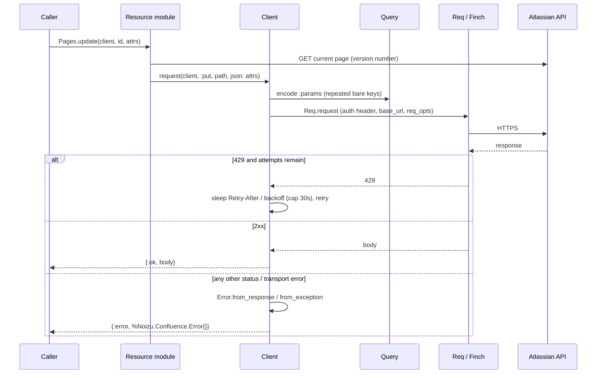

# Project Architecture — `noizu_confluence`

<!-- 〚📁:𔆯𓕼𓢱𓋰〛 docs/PROJ-ARCH.md :: Architecture overview: request pipeline, pagination normalization, optimistic-locking helper, key decisions. -->

## Overview

`noizu_confluence` is a **stateless HTTP client library** for the Confluence
Cloud REST API. There are no processes, no ETS, no application env, and no
global configuration: the caller builds one immutable
`Noizu.Confluence.Client` struct per credential set and passes it explicitly to
every operation. Each function returns `{:ok, map()}` /
`{:error, %Noizu.Confluence.Error{}}`; raising is reserved for programmer error
(bad client options) and mid-stream pagination failures.

The API surface is **v2-first** (`/wiki/api/v2/...`); the v1 API
(`/wiki/rest/api/...`) is used only where v2 has no equivalent (CQL search,
label writes, attachment upload/download, single-user lookups) — each v1
dependency is deliberate and tabulated in
[API-CONTRACT.md](API-CONTRACT.md) §2, which is the system of record for
endpoint coverage.

## System Diagram

## Core Components

| Component | Purpose |
|-----------|---------|
| `Client` | Immutable config struct (`auth_mode`, credentials, `base_url`, retry policy, `req_opts`); owns the request pipeline and 429 retry loop |
| `Query` | Encodes `:params` maps per Atlassian spec semantics (repeated bare keys; `expand` comma-joined) |
| `Pagination` | Follows `_links.next` (Link-header fallback), normalizes continuation URLs against the client base, powers `*_stream/2` |
| `Error` | Exception struct decoding both provider error shapes (v2 `errors[]`, v1 `statusCode/message/data`) |
| Resource modules | `Spaces`, `Pages`, `BlogPosts`, `Comments`, `Attachments`, `Labels`, `Properties`, `Search`, `Users` — thin per-resource wrappers around `Client.request/4` |

→ *Components ↔ directories: see [PROJ-LAYOUT.md](PROJ-LAYOUT.md)*

## Request Pipeline

`Client.new/1` validates the chosen auth mode (`ArgumentError` on missing
credentials) and derives `base_url`: basic auth → `https://<site>/wiki`
(bare site names get `.atlassian.net` appended), OAuth →
`https://api.atlassian.com/ex/confluence/<cloudId>/wiki`. `Client.request/4`
builds a `Req` request with `retry: false` (retrying is handled in-house),
the auth header (`{:basic, email:token}` or `{:bearer, token}`), and the
caller's `req_opts`; the only automatic retry is **429** — honoring
`Retry-After` (capped at 30 s, exponential fallback), at most `max_retries`
(default 3) after the initial attempt, with an injectable `:retry_sleep`.
2xx bodies are returned as decoded maps (or raw binary with
`decode_body: false`); everything else becomes an `Error`.

→ *Detailed status/auth matrix: see [THREAT-MODEL.md](THREAT-MODEL.md)*

## Pagination

Confluence advertises the next page both as a body `_links.next` and a
`Link: <...>; rel="next"` header (both absent on the last page).
`Pagination.next_path/2` prefers the body link, normalizes the URL to a path
relative to the client base (absolute origins are reduced to path + query and
a leading `/wiki` segment is stripped), and `item_stream/3` drives a lazy
`Stream.unfold` that re-fetches pages until the link disappears, flat-mapping
each page's `"results"`. A fetch error mid-stream raises the `Error` (streams
cannot return tuples per item). v1 search uses the same cursor convention, so
one implementation serves both API versions.

## Data Flow

Caller → resource function → `Client.request/4` → Req/Finch → Atlassian →
back as tuples. Content bodies (`storage` XHTML / `atlas_doc_format` ADF /
`wiki`) pass through verbatim — the library generates and converts no
documents. Updates that require optimistic locking (`Pages`, `BlogPosts`,
`Properties`) share one `ensure_version` helper: when `"version"` is omitted
the current entity is fetched and `version.number` is set to current + 1 (one
extra GET, skippable by passing `"version"` explicitly).

## Key Decisions

- **Explicit client, no global state** — multi-site/multi-credential callers
  and `Req.Test` injection stay trivial; nothing to tear down.
- **Custom query encoding** — Req renders list params Plug-style (`key[]=v`);
  the Atlassian specs define repeated bare keys (`ids=1&ids=2`), so `Query`
  encodes params itself (deterministic, sorted, percent-encoded).
- **Retry 429 only** — 5xx and transport errors surface honestly as
  `{:error, ...}` instead of being retried behind the caller's back, per
  Atlassian's bounded-retry recommendation.
- **Plain maps, no struct casting** — responses mirror the provider payloads
  (`"results"`, `"_links"`), so spec changes never require a library release
  to be readable.
- **Contract-first** — [API-CONTRACT.md](API-CONTRACT.md) is updated before
  code when Atlassian evolves the API; v1 usage is enumerated, never implicit.
- **`Req ~> 0.7`** — attachment upload relies on `:form_multipart`, added in
  Req 0.7; Finch/Mint provide the HTTP stack.

## Testing & Tooling

ExUnit suites run entirely against `Req.Test` plugs via factories in
`test/support/support.ex` — no live network, no real tokens; the retry sleep
is injectable so 429 paths are tested without wall-clock waits. `mix.exs`
carries the Hex package metadata; docs are generated with `ex_doc`
(gitignored `doc/` output).

## Threat Posture

The library is a credential-handling HTTP client; its security properties
(basic-auth vs bearer handling, URL normalization on pagination, multipart
temp files, supply chain) are analyzed in [THREAT-MODEL.md](THREAT-MODEL.md).
