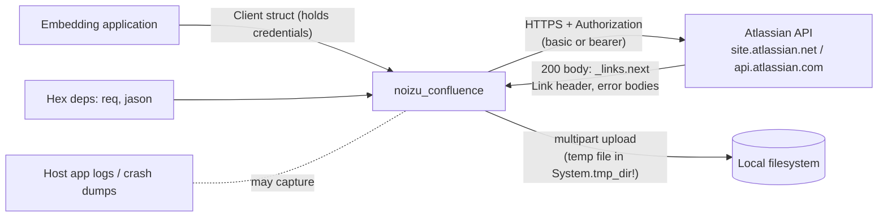

# Threat Model — `noizu_confluence`

<!-- 〚📁:𓉙𔍤𔅉𓶗〛 docs/THREAT-MODEL.md :: STRIDE threat model: credential handling, pagination host-pinning analysis, upload temp files, CQL surface, supply chain; vulnerability register T-001..T-010. -->

Version: 0.1.0 · Date: 2026-10-17
Method: STRIDE over the trust boundaries implied by [PROJ-ARCH.md](PROJ-ARCH.md);
every claim verified against the code on `develop` at `e97981a`.

## Overview

`noizu_confluence` is a **client-side library** with no listening services, no
daemon, and no storage: its security posture is entirely about (1) holding the
caller's Atlassian credentials in memory, (2) deciding which hosts those
credentials are sent to, and (3) how much of a server response is trusted as
input (pagination continuations, error bodies).

**Crown jewels:** the API token / OAuth bearer carried in the `Client` struct,
and the Confluence content the credential can read or write. The library is
embedded into a host application that is **trusted** (it supplies config and
often credentials); Atlassian's API is **semi-trusted** — its responses drive
pagination; the local machine, the network path, and Hex dependencies are
**hostile by default**.

## Trust Boundaries

Four boundaries: **app ↔ library** (trusted config, but see T-002/T-004 for
untrusted values flowing through), **library ↔ Atlassian** (responses are
attacker-influenceable input when the workspace or a proxy is compromised),
**library ↔ local filesystem** (temp files during upload), and
**library ↔ logs/REPL** (credential serialization). Network interception is
out of scope for the library itself: both base URLs are hard-pinned `https://`
and transport is Req/Finch with system CA trust.

## Attack Surface

- `Client.new/1` — credential intake (basic: `site`/`email`/`api_token`;
  OAuth: `cloud_id`/`access_token`); base-URL construction.
- `Client.request/4` / `request_full/4` — the only egress path; auth header
  attached to **every** request, anchored to the pinned `base_url`.
- `Pagination.next_path/2` — trusts `_links.next` (body) and the `Link`
  response header as *input* for the next request URL.
- `Search.cql/3` — caller CQL string passed verbatim.
- All resource modules — ids and attrs interpolated into request paths/bodies.
- `Attachments.upload/4` — multipart body materialized via local temp files.
- `Error.from_response/2` — provider error bodies decoded into a raisable
  exception (surfaces in host logs).

## Vulnerability Register

| ID | Severity | STRIDE | Component | Finding | Status |
|----|----------|--------|-----------|---------|--------|
| T-001 | **Medium** | Info disclosure | `Client` struct | No custom `Inspect`: `inspect(client)` / crash dumps render `api_token` / `access_token` in cleartext — leaks into host logs, REPL history, error reports | **Open** |
| T-002 | **Medium** | Info disclosure / Tampering | `Attachments.upload/4` | `{:data, filename, _}` — `filename` is interpolated into the temp path unvalidated (`Path.join(tmp, "noizu-confluence-upload-" <> rand <> "-" <> filename)`); a name containing `/` or `..` writes caller content **outside the tmp dir**. Benign when the embedder controls the name; dangerous when an embedder forwards user-supplied filenames (a common web-app pattern) | **Open** |
| T-003 | Low | Info disclosure | `Attachments.upload/4` | Temp files are written with default permissions (0644) into a shared `System.tmp_dir!`; upload content is readable by other local users until removed (`try/after` does delete on normal paths) | **Open** |
| T-004 | Low | Tampering | Resource modules | Path/id parameters (page ids, attachment ids, label names via `?name=`) are `to_string`-interpolated **without URI encoding**; a crafted id can inject extra path segments or a query string. Requests stay on the pinned host with the same privileges, so impact is endpoint confusion / unintended operations within the token's authority | **Open** |
| T-005 | Low | Tampering | `Search.cql/3` | CQL is a query language and is passed verbatim (the correct library behavior); embedders who build CQL by string concatenation from user input face **CQL logic injection** (tainted searches within the token's permissions). The library ships no CQL escaping helper | **Accepted (library scope)** — embedder responsibility, documented |
| T-006 | Low | Info disclosure | `Client.new/1` | Basic-auth credentials follow caller-configured `site` verbatim: an attacker able to influence the `site` option receives `email:api_token` in the Authorization header to their own HTTPS host. Config is trusted, so this requires config-injection in the host app | **Accepted** (trusted config); an `*.atlassian.net` allowlist option would close it |
| T-007 | Low | Tampering | `Pagination` | A compromised/median response controls continuation: it can keep `_links.next` alive indefinitely (**unbounded crawl** — rate-limit burn, content exfil at crawl speed) or steer arbitrary paths/queries **on the legitimate host** | **Accepted** — bounded only by stream termination; see Mitigations |
| T-008 | Low | DoS | `Client` retry loop | Attacker-supplied `Retry-After` can stall a request, but is parsed strictly (non-negative integer) and capped at 30 s, with ≤ `max_retries` (3) retries — worst case ~90 s + 4 requests per operation | **Mitigated** |
| T-009 | Low | Tampering (supply chain) | Dependencies / CI | No CI exists (no `.github/`), so no automated `mix hex.audit` / dependency-advisory step; runtime surface is small (`req ~> 0.7` → finch/mint/hpax/nimble_*, `jason ~> 1.4`; plug test-only; ex_doc dev-only) and locked in `mix.lock` for development, but consumers resolve their own versions | **Open** (process gap) |
| T-010 | Low | Tampering | OAuth base URL | `cloud_id` is interpolated into the path of the **pinned** `https://api.atlassian.com` base; a malformed `cloud_id` can at worst confuse the path on the same Atlassian host (bearer remains Atlassian-scoped) | **Mitigated by design** |

## Explicit finding: pagination cannot redirect the auth header cross-host

**T-question: can a malicious response send the client and its Authorization
header to another host? No.** The mechanics, verified in
`lib/noizu/confluence/pagination.ex` and `client.ex`:

1. `Pagination.next_path/2` takes `_links.next` from the body (preferred) or
   the `Link: <...>; rel="next"` header (fallback).
2. `normalize_path/1` → `from_absolute/1` parses absolute URLs and keeps
   **only `path` + `query`** — scheme and host are **discarded**; relative
   paths skip this step.
3. Every request, including every continuation, is built with
   `base_url: client.base_url` (`build_request/4`), and `Req` resolves the URL
   against that base — the auth header (`{:basic, email:token}` or
   `{:bearer, token}`) is attached to that same request object. There is no
   code path that adopts a response-supplied origin.

So a hostile `_links.next` such as `https://evil.example/collect?a=b` degrades
to the path `/collect?a=b` served by the **configured** Atlassian host
(T-007's same-host steering) — the credential never leaves the pinned origin.

## Mitigation Coverage

- **By design (host pinning):** T-007 (cross-host leg), T-008 (bounded retry),
  T-010 (OAuth path) — all requests anchored to `base_url` from client config;
  only 429 retried; `Retry-After` strictly parsed and capped.
- **By hygiene:** the library never logs (`Logger` absent from `lib/`), and
  its own `inspect/1` uses in `ArgumentError` messages render only option
  **labels**, never credential values; error structs carry status/code/message
  and provider bodies, never request headers.
- **Open items:** T-001 (redact secrets from `Inspect`), T-002 (sanitize
  `filename` with `Path.basename/1` and reject `..`), T-003 (0600 temp files),
  T-004 (URI-encode path segments), T-009 (CI + `mix hex.audit`).
  Owner: noizu-labs/noizu_confluence maintainers.

## Residual Risk

- **Trusted-config assumption (T-005, T-006):** the library treats `site`,
  `cloud_id`, and CQL as trusted caller input. A host app that forwards these
  from untrusted sources without validation owns the consequences.
- **Semi-trusted API responses (T-007):** a compromised Atlassian workspace
  or TLS-terminating proxy can prolong crawls and pick same-host paths; it
  cannot escalate privileges (the token already bounds them) or move the
  credential off-origin.
- **Local artifacts (T-003):** brief 0644 temp files during `{:data, ...}`
  uploads; residue only on unclean VM shutdown.
- **Supply chain (T-009):** trust in Hex-published `req`/`jason` versions
  resolved by consumers; no pinning enforcement beyond `mix.lock` (dev-only).

→ *Grounding: components in [PROJ-ARCH.md](PROJ-ARCH.md), file map in
[PROJ-LAYOUT.md](PROJ-LAYOUT.md), endpoint facts in
[API-CONTRACT.md](API-CONTRACT.md).*
